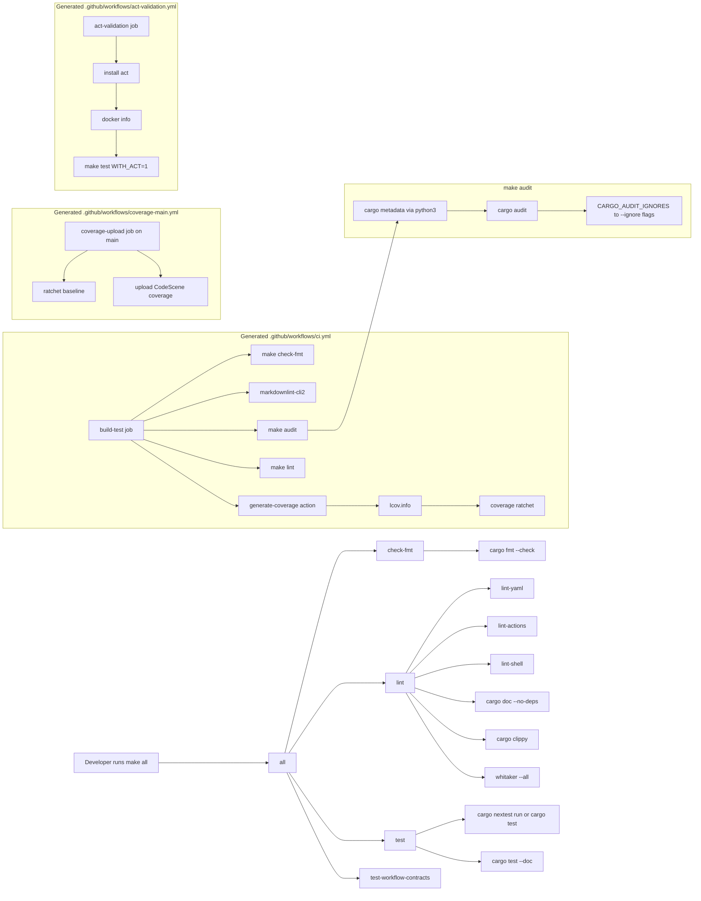

# Testing

This project uses [pytest](https://pytest.org) with the
[pytest-copier](https://github.com/copier-org/pytest-copier) plugin to verify
the Copier template renders correctly.

Run the tests after making changes to the template:

```bash
pip install -r requirements.txt
pytest
```

The tests build the rendered project and validate the generated Makefile with
`mbake`. They also run `cargo clippy` so lint warnings are treated as errors.

## Generated Quality Gate Flow

Figure: The generated `make all` quality gate verifies formatting, linting, and
tests. The main generated CI workflow also runs the audit and coverage targets;
the separate Act validation workflow runs the parent template tests with
`WITH_ACT=1` so rendered workflow checks do not slow the main CI path.


